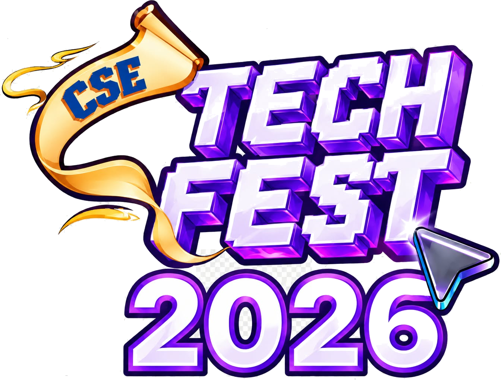

# 🎓 CSE Tech Fest 2026 - Certificate Generator Studio & Automation Suite

<p align="center">
  
  <br>
  <strong>Official Automated Certificate Generation Suite for CSE Tech Fest 2026</strong>
  <br>
  <em>Department of Computer Science & Engineering (CSE), BGC Trust University Bangladesh (BGCTUB)</em>
</p>

<p align="center">
  
  
  
  
  
</p>

---

## 📌 Overview

**CSE Tech Fest 2026 Certificate Generator Studio** is a dual-engine certificate generation system designed to produce print-ready, high-resolution awards and credentials for fest winners, participants, and leadership committee members.

The repository offers two complementary workflows:
1. **Interactive Web Studio (`index.html`)**: A client-side visual suite featuring live preview, theme selector, dynamic multi-logo alignment, and instant PDF/PNG export right from the browser.
2. **Batch Production Pipeline (`generate_all_certificates.py`)**: An automated Python pipeline powered by **Pillow (PIL)** and **ReportLab** that renders all 23 official certificates at standard **A4 Landscape 300 DPI (3508 × 2480 px)** and compiles them into a single publication-grade PDF.

---

## ✨ Key Features

- **🏆 Production Print Quality (300 DPI A4)**:
  - Generates ultra-crisp 3508 × 2480 px PNG files ready for professional offset or digital printing.
  - Automatically compiles a combined multi-page vector-aligned PDF (`CSE_Tech_Fest_2026_All_23_Certificates.pdf`).

- **🎨 Dynamic Theme & Layout Engine**:
  - **Refined Geometric Navy & Gold**: Premium corporate design featuring geometric corner facets and subtle security guilloche watermarks.
  - **Cyber Vibe**: Modern futuristic dot matrix grid and neon cyan accents tailored for tech festivals.
  - **Royal Prestige & Modern Luxury**: Timeless classical borders for prestige accolades.

- **🏛️ Intelligent Multi-Logo & Signature Architecture**:
  - **3-Logo Layout (Club-Affiliated Events)**: Left (*BGCTUB*), Center (*Tech Fest*), Right (*Robotics Club* or *Coding Club*), with 3-signature alignment (Event Coordinator, Department Chairman, Vice Chancellor).
  - **2-Logo Layout (Olympiads & Leadership)**: Symmetrical Left & Right placement with adaptive 2-signature or 3-signature formatting.

- **✒️ Hand-Crafted Calligraphy & Modern Typography**:
  - Uses Google Fonts calligraphy (`Alex Brush`) for distinguished recipient names.
  - Balanced serif and modern sans-serif hierarchy for legal and academic credentials.

- **⚡ Zero-Dependency Web Studio**:
  - Open `index.html` in any modern web browser without npm, node, or web servers.
  - Built-in live editing for recipient names, roles, contest titles, date stamps, and signature blocks.

---

## 📂 Repository Structure

```text
CSE_Tech_Fest_26_Certificate_Generator/
│
├── index.html                               # Interactive Certificate Studio (Web GUI)
├── generate_all_certificates.py             # Automated Batch Generator (A4 300 DPI + PDF)
├── create_refined_corner_bg.py              # Generator script for Refined Luxury Gold template
├── generate_tech_fest_bg.py                 # Generator script for Cyber Tech Fest template
│
├── CSE_Tech_Fest_2026_All_23_Certificates.pdf # Ready-to-print multi-page master PDF
│
├── Generated_Certificates_PNG/              # Directory of 23 high-res individual certificates
│   ├── 01_Mohammad_Jamshidul_Hafiz_Champion.png
│   ├── 02_Mst_Subrina_Sultana_Champion.png
│   ├── ...
│   └── 23_Mohammad_Tareq_Aziz_Operations___Execution_Lead.png
│
├── fonts/                                   # Typography assets
│   └── AlexBrush-Regular.ttf
│
├── cert_bg_refined_corners.png              # High-res 2048x1364 master background
├── cert_bg_refined_corners_1x.png           # Web-optimized background
├── cert_bg_tech_fest_vibe.png               # Cyber theme background
├── cert_bg_royal_prestige.png               # Royal theme background
├── cert_bg_modern_luxury.png                # Modern luxury theme background
├── cert_bg_clean.png                        # Clean minimalist background
│
├── BGCTUB_Logo_clean.png                    # Institutional University Logo
├── Tech_Fest_Logo_clean.png                 # Official 3D Fest Logo
├── BGCTUB_Robotics_Logo.png                 # Robotics & IoT Club Logo
├── BGCTUB_Coding_Club_clean.png             # Coding Club Logo
├── ACS_Logo_transparent.png                 # Association of Computer Students Logo
│
├── .gitignore                               # Standard Git ignore file
└── README.md                                # Project documentation
```

---

## 🚀 Getting Started

### 1. Interactive Web Studio (Quickest Way)
No installation needed:
1. Double-click or open [index.html](file:///c:/Users/HP/OneDrive/Desktop/CSE_Tech_Fest_26_Certificate_Generator/index.html) in any web browser (Chrome, Edge, Firefox, Safari).
2. Select any recipient preset from the dropdown or manually type any custom name and event.
3. Switch themes, toggle logos, or modify coordinators.
4. Click **Download PNG** or **Generate PDF**.

---

### 2. Python Batch Generation Pipeline

#### Prerequisites
- Python 3.8 or higher installed on your system.

#### Installation
Install the necessary imaging and PDF dependencies:
```bash
pip install pillow reportlab
```

#### Running the Generator
Run the main generation script from the project root:
```bash
python generate_all_certificates.py
```

The script will:
1. Batch process all 23 official certificates defined in the registry.
2. Render each certificate at **A4 Landscape (3508 × 2480 pixels @ 300 DPI)** in `Generated_Certificates_PNG/`.
3. Compile all pages into standard A4 Landscape PDF: `CSE_Tech_Fest_2026_All_23_Certificates.pdf`.

---

## 🏅 Fest Events & Awardees Registry

| Segment | Event | Role / Award | Affiliated Club / Signatory |
| :--- | :--- | :--- | :--- |
| **01** | Robotics & IoT Project Exhibition | Champion & Runner-up | BGCTUB Robotics Club + Coordinator |
| **02** | Programming Contest | Champion, 1st Runner-up, 2nd Runner-up | BGCTUB Coding Club + Coordinator |
| **03** | IT Olympiad | 1st, 2nd, 3rd Position | Academic Committee + Coordinator |
| **04** | Physics & Mathematics Olympiad | 1st, 2nd, 3rd Position | Faculty Coordinator |
| **05** | Festival Leadership & Committee | Documentation & Publication Lead, Operations & Execution Lead | Symmetrical Executive Signatures |

---

## 🛠️ Customization Guide

### Adding or Modifying Recipients
To add or update awardees, open [generate_all_certificates.py](file:///c:/Users/HP/OneDrive/Desktop/CSE_Tech_Fest_26_Certificate_Generator/generate_all_certificates.py) and update the `certificates` list:

```python
{
    "event": "Programming Contest",
    "cat": "Programming",
    "role": "Champion",
    "name": "Your Participant Name",
    "coord": "Coordinator Name",
    "coord_role": "Coordinator\nProgramming Contest\nCSE Tech Fest 2026, BGCTUB",
    "right_logo": CODING_LOGO_PATH,
    "has_coord": True
}
```

### Regenerating Background Themes
To create new background variations programmatically:
```bash
# Generate refined luxury navy & gold corner background
python create_refined_corner_bg.py

# Generate cyber grid tech fest background
python generate_tech_fest_bg.py
```

---

## 👥 Credits & Acknowledgments

- **Host Institution**: [BGC Trust University Bangladesh (BGCTUB)](https://www.bgctub.ac.bd/)
- **Department**: Department of Computer Science & Engineering (CSE)
- **Organizing Club Partners**:
  - BGCTUB Robotics Club
  - BGCTUB Coding Club
  - Association of Computer Students (ACS)
- **Documentation & Publication Lead**: Md. Tahmidul Alam Ahad

---

<p align="center">
  <sub>Built with ❤️ for CSE Tech Fest 2026 • Department of Computer Science & Engineering, BGCTUB</sub>
</p>
